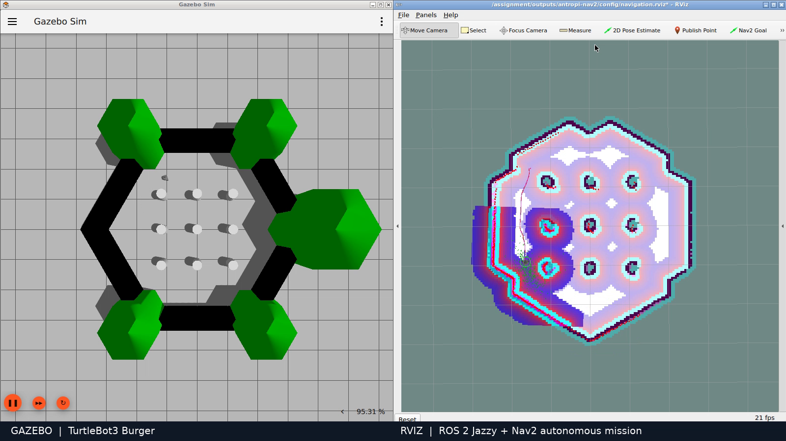

# TurtleBot3 inspection mission — ROS 2 + Nav2

A repeatable two-station navigation mission through the TurtleBot3 obstacle
world, with Gazebo simulation, RViz visualization and measured action outcomes.
Prepared for the Antropi Robotics Software Intern assignment.

**Verified:** two autonomous goals succeeded in the recorded run, in 52.235 s
total. The independent live diagnostics passed all 15 checks. See
[actual test results](docs/verification.md) and [recorded mission data](evidence/mission.json).



The 75-second screen recording is delivered alongside this repository as
`evidence/demo.mp4` (release asset when published). It shows actual Gazebo/RViz
execution at normal speed.

## Run on Ubuntu 24.04 / ROS 2 Jazzy

Install ROS 2 from the official instructions first:
https://docs.ros.org/en/jazzy/Installation/Ubuntu-Install-Debs.html

```bash
sudo apt-get update
sudo apt-get install ros-jazzy-turtlebot3-gazebo \
  ros-jazzy-turtlebot3-navigation2 ros-jazzy-nav2-simple-commander ros-jazzy-rviz2 \
  ros-jazzy-ros2launch
bash scripts/run.sh
```

In a second terminal, from this repository:

```bash
bash scripts/mission.sh
```

The mission sets the initial localization pose to match the spawn pose and waits
for Nav2 to become active. It then requests goals `(1.5, 1.5)` and `(-1.5, 1.5)`.
Nav2 plans and drives the robot; the script does not publish velocity commands.
Results are written to `evidence/mission.json`. Exit code 0 requires both goals
to succeed. Startup and mission execution have bounded timeouts.

To send a different mission, restart the simulation so the initial pose matches:

```bash
bash scripts/mission.sh --goals '[[1.5, 1.5, 0.0]]' --output evidence/single-goal.json
```

## Docker desktop (Linux, x86-64)

The Docker option supplies an isolated Ubuntu environment and a browser-viewable
virtual desktop. Allow approximately 5 GB free space for the image/build.

```bash
docker build -t antropi-nav2 .
docker run --rm --init --name antropi-demo --shm-size=512m \
  -p 127.0.0.1:6080:6080 antropi-nav2
```

Open http://localhost:6080/vnc.html and connect. In two host terminals:

```bash
docker exec -it antropi-demo bash scripts/run.sh
docker exec -it antropi-demo bash scripts/mission.sh
```

Copy the evidence out before stopping the container:

```bash
docker cp antropi-demo:/demo/evidence ./run-evidence
```

The browser desktop is unauthenticated and must remain bound to localhost.
Software rendering can be slower than real time; the mission timeout is measured
in wall-clock seconds. Native Ubuntu with GPU rendering is preferable if needed.

## What to watch

- Gazebo: the physical robot driving around the cylinder obstacles.
- RViz: the laser scan, inflated obstacle costs and planned path.
- Terminal/JSON: successful Nav2 action outcomes, elapsed time and goal error.

The default navigation parameters come from ROBOTIS' Jazzy Burger configuration.
See [design decisions](docs/design.md), [assignment requirements](docs/assignment.md)
and [upstream attribution](THIRD_PARTY.md). The map and world are supplied by the
installed TurtleBot3 packages; this project does not reimplement navigation.

## Tests and diagnostics

```bash
source /opt/ros/jazzy/setup.bash
python3 -m unittest discover -s tests -v
export ROS_DOMAIN_ID=73
# Run after mission startup has supplied the initial AMCL pose:
python3 scripts/doctor.py --duration 10 --output evidence/doctor.json
```

Record a fresh run inside the supplied virtual desktop, then start the mission
in another terminal:

```bash
DISPLAY=:99 bash scripts/record.sh
```

Recording refuses to overwrite an existing file; pass a new absolute output
path as its first argument for another take. Restart the simulation before each
mission so the localization initial pose matches the robot's physical pose.

## Results and limitations

| Recorded goal | Wall time | Odometry distance | Estimated positional error |
|---|---:|---:|---:|
| (1.5, 1.5) | 32.357 s | 5.299 m | 0.0464 m |
| (-1.5, 1.5) | 19.878 s | 3.098 m | 0.0201 m |

The practical additions are a repeatable action-driven mission with measured
results, and a bounded read-only diagnostic tool. Neither replaces Nav2.

The actual runtime was installed and exercised in a fresh Ubuntu 24.04 container
on an Arch host. The final Dockerfile has **not** been independently clean-built
because of the host disk budget. [Tested package versions](evidence/package-versions.tsv)
are recorded; apt dependencies and the Ubuntu base tag are not fully locked.
No physical hardware was tested. Sensor-range minima are not footprint-clearance
or contact guarantees, and AMCL error is an estimate rather than ground truth.
The software renderer emitted a startup GLSL warning, but the map, costmaps and
robot were visibly rendered in the demo.

See [troubleshooting](docs/troubleshooting.md), [architecture](docs/design.md),
[requirements checklist](docs/acceptance.md), and the
[interview guide](docs/interview-guide.md). AI assistance is disclosed in
[THIRD_PARTY.md](THIRD_PARTY.md).
