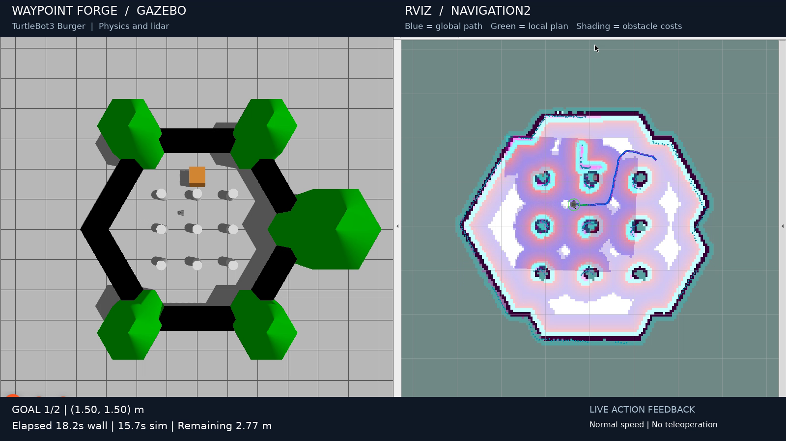
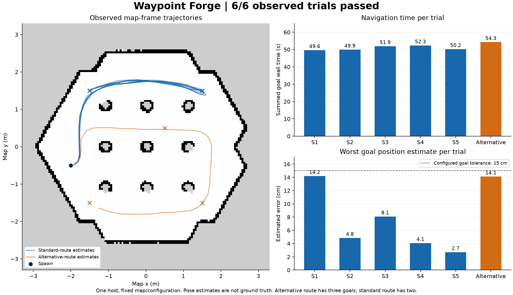

# Waypoint Forge — TurtleBot3 inspection mission

A repeatable two-station navigation mission through the TurtleBot3 obstacle
world, with Gazebo simulation, RViz visualization and measured action outcomes.
Prepared for the Antropi Robotics Software Intern assignment.

**Measured:** six fresh simulation trials passed all 13 requested goals.
The five repeated standard missions had a median summed goal time of **50.224 s**.
Every trial passed the live diagnostics and process-cleanup checks. These are
observed results on one host, not a statistical reliability guarantee.





See the [benchmark and raw evidence](docs/benchmark.md),
[live mission telemetry](docs/mission-evidence.md), and
[optional unmapped-obstacle experiment](docs/unmapped-obstacle.md).

[Watch or download the 90-second demo](https://github.com/Preethesh16/waypoint-forge/releases/download/v1.1.0/demo.mp4)
from the [v1.1.0 release](https://github.com/Preethesh16/waypoint-forge/releases/tag/v1.1.0).
The recording shows both goals succeeding with an added orange crate absent
from the static map, actual Gazebo/RViz execution and live action feedback.
The sensor-driven costmap check passed; the demonstration mission took 58.01 s
including client initialization.
The release also contains the complete submission ZIP and benchmark report.

## Run on Ubuntu 24.04 / ROS 2 Jazzy

Install ROS 2 from the official instructions first:
https://docs.ros.org/en/jazzy/Installation/Ubuntu-Install-Debs.html

```bash
sudo apt-get update
sudo apt-get install ros-jazzy-turtlebot3-gazebo \
  ros-jazzy-turtlebot3-navigation2 ros-jazzy-nav2-simple-commander ros-jazzy-rviz2 \
  ros-jazzy-ros2launch
bash scripts/run.sh
```

In a second terminal, from this repository:

```bash
bash scripts/mission.sh
```

The mission sets the initial localization pose to match the spawn pose and waits
for Nav2 to become active. It then requests goals `(1.5, 1.5)` and `(-1.5, 1.5)`.
Nav2 plans and drives the robot; the script does not publish velocity commands.
Results are written to `evidence/mission.json`. Exit code 0 requires both goals
to succeed. Startup and mission execution have bounded timeouts.

To send a different mission, restart the simulation so the initial pose matches:

```bash
bash scripts/mission.sh --goals '[[1.5, 1.5, 0.0]]' --output evidence/single-goal.json
```

## Docker desktop (Linux, x86-64)

The Docker option supplies an isolated Ubuntu environment and a browser-viewable
virtual desktop. Allow approximately 5 GB free space for the image/build.

```bash
docker build -t antropi-nav2 .
docker run --rm --init --name antropi-demo --shm-size=512m \
  -p 127.0.0.1:6080:6080 antropi-nav2
```

Open http://localhost:6080/vnc.html and connect. In two host terminals:

```bash
docker exec -it antropi-demo bash scripts/run.sh
docker exec -it antropi-demo bash scripts/mission.sh
```

Copy the evidence out before stopping the container:

```bash
docker cp antropi-demo:/demo/evidence ./run-evidence
```

The browser desktop is unauthenticated and must remain bound to localhost.
Software rendering can be slower than real time; the mission timeout is measured
in wall-clock seconds. Native Ubuntu with GPU rendering is preferable if needed.

## What to watch

- Gazebo: the physical robot driving around the cylinder obstacles.
- RViz: the laser scan, inflated obstacle costs and planned path.
- Terminal/JSON: successful Nav2 action outcomes, elapsed time and goal error.

The default navigation parameters come from ROBOTIS' Jazzy Burger configuration.
See [design decisions](docs/design.md), [assignment requirements](docs/assignment.md)
and [upstream attribution](THIRD_PARTY.md). The map and world are supplied by the
installed TurtleBot3 packages; this project does not reimplement navigation.

## Tests and diagnostics

```bash
source /opt/ros/jazzy/setup.bash
python3 -m unittest discover -s tests -v
export ROS_DOMAIN_ID=73
# Run after mission startup has supplied the initial AMCL pose:
python3 scripts/doctor.py --duration 10 --output evidence/doctor.json
```

To record a fresh run with the real mission-status overlay, follow the
[demo guide](docs/demo-guide.md). Initialize localization first, start recording,
then run the mission with `--skip-initial-pose`. Restart the simulator before
starting a new normally initialized mission.

## Results and limitations

| Repeated experiment | Result |
|---|---:|
| Standard two-goal route | 5/5 trials, 10/10 goals |
| Alternative three-goal route | 1/1 trial, 3/3 goals |
| Standard summed goal time | 49.642–52.322 s; median 50.224 s |
| Maximum fresh estimated final position error | 0.1420 m |

The practical additions are a bounded action-driven mission, timestamped live
telemetry, a repeatability harness, read-only diagnostics, and a sensor-driven
obstacle experiment. They use the upstream Nav2 navigation algorithms.

The actual runtime was exercised in an Ubuntu 24.04 container on an Arch host.
The Dockerfile pins the Ubuntu manifest, ROS signing-key revision and principal
ROS package versions. Transitive apt dependencies remain mutable. See
[reproducibility and clean-build verification](docs/reproducibility.md).
No physical hardware was tested. Sensor-range minima are not footprint-clearance
or contact guarantees, and AMCL error is an estimate rather than ground truth.
The software renderer emitted a startup GLSL warning, but the map, costmaps and
robot were visibly rendered in the demo.

See [troubleshooting](docs/troubleshooting.md), [architecture](docs/design.md),
[requirements checklist](docs/acceptance.md), and the
[interview guide](docs/interview-guide.md). AI assistance is disclosed in
[THIRD_PARTY.md](THIRD_PARTY.md).
