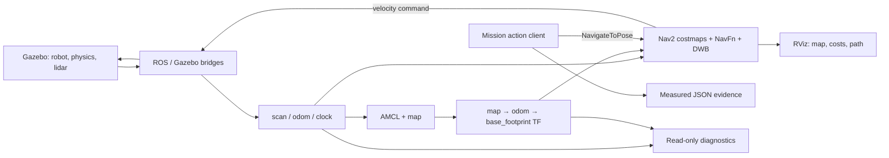

# Design decisions

The demo treats navigation as a small inspection mission: travel from the spawn
pose to two stations around the cylinder field. A Python client sends
`NavigateToPose` actions; Nav2 owns path planning, control and recovery. There is
no teleoperation or scripted velocity playback in the mission.

## Architecture

Gazebo simulates the Burger robot, wheel odometry and laser scan. ROS/Gazebo
bridges connect the simulation to ROS 2. Robot State Publisher supplies the robot
transforms. AMCL localizes the robot against the supplied TurtleBot3 map.
NavFn plans through the global costmap, and DWB selects local velocity commands.
Costmap obstacle and inflation layers account for obstacles and robot clearance.
RViz shows localization, laser observations, costmaps and planned paths.

All nodes use simulation time. The initial pose supplied to AMCL matches the
Gazebo spawn pose (-2.0, -0.5, yaw 0). A dedicated ROS domain avoids interference
with other local ROS experiments. A per-run Gazebo transport partition also
prevents cross-talk with another Gazebo world. The launcher owns a separate
process group, requests orderly ROS shutdown, then performs bounded cleanup of
remaining child processes.

The checked-in configuration changes the upstream default speed cap to 0.22 m/s,
sets both costmap radii to 0.12 m, and requests a 0.15 m positional goal tolerance.
The velocity smoother uses matching linear and angular limits. The DWB stopped
threshold is 0.03 m/s; keeping the upstream 0.25 m/s threshold above the new speed
cap would incorrectly classify all permitted forward speeds as stopped.

The collision monitor's scan source timeout is 0.50 s. The actual simulator
publishes laser scans at 5 Hz (0.20 s intervals); the upstream 0.20 s timeout
rejected normal jitter, producing repeated stops. The revised setting tolerates
two normal scan periods while retaining a finite stale-data stop threshold.
At the 0.22 m/s cap, 0.50 s corresponds to 0.11 m of travel before detection;
this excludes braking and other latency and is not a hardware safety argument.

## Evidence and limits

The mission writes action outcomes, wall duration, integrated odometry distance,
the last observed AMCL position and minimum valid laser range to JSON. A failed
or timed-out goal stops the mission and yields a nonzero exit code. The outer
shell timeout also bounds startup/localization waits.

Laser range is measured from the sensor and is **not** the distance from the
robot footprint. A successful action and a video are not a formal proof that
there were no contacts. AMCL goal error is an estimate rather than Gazebo ground
truth. Timing depends on rendering speed and host load.

This is a known-map static-obstacle demonstration, not a SLAM implementation or
a claim of real-world deployment readiness.
