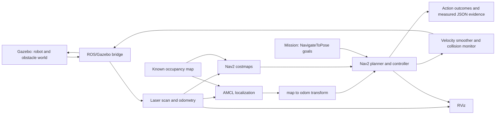

# Explaining the project

## A concise explanation

“I integrated TurtleBot3's Gazebo simulation with ROS 2 Jazzy Navigation2. The
robot uses a known map and AMCL localization, plans around obstacles with NavFn,
and follows the path using DWB. My mission client sends action goals and records
the actual results, rather than driving the robot with prerecorded commands.”

Only describe tests and numbers actually present in the final evidence files.
The simulator, model, map and navigation algorithms are upstream work; the
project contribution is their integration, configuration, mission orchestration,
verification and delivery. AI assistance is disclosed in `THIRD_PARTY.md`.

## How the components fit

## Questions to be ready for

**Why a known map instead of SLAM?** The assignment asks for autonomous navigation
and permits existing maps. A known map removes unnecessary mapping variability
and keeps the demonstration focused on localization, planning and control.

**What is AMCL doing?** It maintains a particle-based estimate of the robot's pose
on the known map, using laser observations and motion updates. The initial pose
must agree with the simulator's starting pose. AMCL is an estimate, not ground
truth.

**Why distinguish map, odom and base frames?** `odom` gives locally continuous
motion that can drift; `map` is globally corrected by localization; `base_link`
represents the robot body. Their transforms let scans, robot pose and the global
path be compared in consistent coordinate frames.

**How does obstacle avoidance work?** Costmaps combine mapped and sensed
obstacles. Inflation adds cost near occupied cells. NavFn computes a global
path; DWB evaluates candidate local velocities against trajectory critics. The
velocity smoother and collision monitor sit downstream. None of those layers is
a substitute for real-world safety validation.

**Why adjust both the speed and stopped threshold?** At a 0.22 m/s speed cap, a
0.25 m/s stopped threshold would classify even allowed forward motion as stopped.
The project uses 0.03 m/s for that threshold and matching smoother limits.

**What does successful navigation prove?** A successful `NavigateToPose` result
shows Nav2 reached its configured goal tolerances for that run. It does not prove
zero physical contacts or robustness to every unseen obstacle arrangement.

**Why not call the minimum scan range clearance?** The laser measurement starts
at the sensor, not the edge of the robot footprint. It is useful context but does
not directly establish robot-obstacle clearance. The reported AMCL goal error is
also an estimate based on the last received localization message.

**What happens on timeout?** The mission requests cancellation and waits only a
bounded interval for acknowledgement and terminal action result. The report must
say if those were received. A process timeout alone does not prove the independent
Nav2 server stopped a goal.

**What would you improve next?** Add an independent ground-truth/contact monitor,
repeat trials across layouts and random seeds, and measure how path length,
completion rate and run time change. These are future tests, not completed claims.

## Measured clean-run results

The clean run in `evidence/mission-clean.json` completed both goals successfully.
The first took 31.967 seconds and the second 20.179 seconds in wall time. Reported
odometry path lengths were 5.278 m and 3.174 m. Last-observed AMCL positional errors
were approximately 1.3 cm and 4.0 cm. Those errors are localization estimates,
not independently measured ground-truth accuracy.

The independent clean diagnostics passed all 15 checks. The graph inspection
found one simulation-clock publisher and consistent `TwistStamped` velocity
interfaces. Earlier integration exposed two instructive issues: a stale-scan
threshold equal to the nominal 0.2 s sensor period caused nuisance stops, and
orphaned Gazebo processes from incomplete shutdown could contaminate a restart.
The fixes add a documented 0.5 s scan freshness margin and whole-process-group
cleanup plus a per-run Gazebo transport partition.

A final clean Dockerfile build is not a completed test: dependencies were
installed and exercised inside a blank Ubuntu container, while disk constraints
prevented a separate fresh image build. Be precise about that distinction.

## Useful differentiation

The two intentional additions are a repeatable action-based mission with measured
results, and read-only runtime diagnostics with bounded failure reporting. They improve reproducibility and
reviewability without replacing proven navigation components.

## Primary references

- [ROBOTIS TurtleBot3 Jazzy setup](https://emanual.robotis.com/docs/en/platform/turtlebot3/quick-start/)
- [Gazebo and ROS version compatibility](https://gazebosim.org/docs/harmonic/ros_installation/)
- [Nav2 Jazzy Simple Commander API](https://docs.nav2.org/jazzy/configuration_and_development/simple_commander_api/simple_commander_api/)
- [Upstream TurtleBot3 Jazzy navigation configuration](https://github.com/ROBOTIS-GIT/turtlebot3/blob/jazzy/turtlebot3_navigation2/param/burger.yaml)
