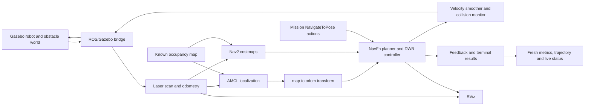

# Explaining the project

## A concise explanation

“I integrated TurtleBot3's Gazebo simulation with ROS 2 Jazzy Navigation2. AMCL
localizes against a supplied map; NavFn plans globally and DWB follows the path.
My client sends actual navigation actions and records outcomes, timing and fresh
pose estimates. I verified five fresh-start repetitions plus a different route:
all six missions and thirteen goals succeeded in that small simulation suite.”

The robot, world, map and navigation algorithms are upstream work. The project
contribution is integration, configuration, mission orchestration, diagnostics,
evidence collection and delivery. AI assistance is disclosed in `THIRD_PARTY.md`.
Describe only the experiments and measurements present in the evidence files.

## Architecture

## Questions to be ready for

**Why a known map instead of SLAM?** The assignment permits existing maps and
requires navigation, not mapping. A supplied map keeps the exercise focused on
localization, planning and control.

**What does AMCL do?** It maintains a particle-based pose estimate on the known
map using laser observations and motion updates. The initial pose must agree with
Gazebo's spawn pose. The estimate is not simulator ground truth.

**Why distinguish map, odom and base frames?** `odom` is locally continuous but
can drift; `map` is corrected by localization; `base_link` represents the robot.
TF connects these frames so observations and paths can be compared consistently.

**How does obstacle avoidance work?** Costmaps combine mapped and sensed
obstacles; inflation adds cost near occupied cells. NavFn computes the global
path. DWB evaluates candidate velocities using trajectory critics. Velocity
smoothing and collision monitoring operate downstream. This is not a substitute
for real-world safety validation.

**What did you actually tune?** The forward speed cap is 0.22 m/s, with matching
smoother limits and a 0.03 m/s stopped threshold. The old 0.25 m/s threshold would
classify permitted motion as stopped. The costmap radius is 0.12 m and positional
goal tolerance 0.15 m. A scan timeout equal to the measured 5 Hz sensor period
caused nuisance stops; the configured 0.5 s timeout leaves timing margin while
retaining bounded stale-input handling.

**What does a successful action prove?** Nav2 reached its configured tolerances
in that run. It does not prove zero contacts, ground-truth accuracy or robustness
to every possible obstacle arrangement.

**Why change the goal-error metric?** An old localization message may understate
or overstate the endpoint error. Schema 2 checks both simulation timestamp and
wall receipt age, and chooses a fresh map-frame estimate from Nav2 feedback or
AMCL. If none is fresh, error is unavailable rather than zero. This improves the
honesty of the measurement, not necessarily the robot's actual accuracy.

**Why are the new errors not directly comparable to v1.0?** v1.0 used the last
received AMCL position. v1.1 can choose fresher navigation feedback. Different
measurement selection is not an algorithm-accuracy improvement, and neither
measurement is ground truth.

**What does the live status show?** Actual mission phase, goal, wall/simulation
time and fresh navigation feedback. Stale remaining-distance feedback is labeled
as unavailable instead of being presented as current. Atomic file replacement
keeps overlay readers from seeing partial text. `--initialize-only` localizes
without sending goals; `--skip-initial-pose` lets a later mission use that
localization without resetting it.

**Is the benchmark deterministic?** It repeats the same documented setup from a
fresh simulator and checks source hashes. AMCL particles, scheduling and physics
may vary; there is no bitwise-replay or fixed-random-seed claim. Each run verifies
a fresh unique clock and cleans up its own processes.

**What do six successes establish?** Six observed successes on one host, map and
configuration. The standard mission succeeded five times; its summed goal-time
median was 50.224 s, range 49.642–52.322 s. The distinct three-goal route succeeded
once in 54.281 s. That sample does not establish a 100% reliability probability.

**Why not call scan range clearance?** Range starts at the sensor, not the robot
footprint. A minimum range is useful context but not a direct clearance or
collision measurement.

**What happens on timeout or Ctrl-C?** The mission requests cancellation and
waits a bounded time for a response and terminal result. The report records what
was received. Testing also independently observed a CANCELED action and the
robot settling. Killing a client alone would not prove the Nav2 server stopped.

**What startup/shutdown defect did you find?** Gazebo grandchildren could survive
launcher-only shutdown and contaminate a new simulation. The wrapper now owns an
isolated process group, uses bounded cleanup and sets a unique Gazebo transport
partition. Clock freshness and publisher count are checked in every benchmark.

**What did the crate experiment establish?** The actual observer found all 144
static-map cells in the probe region free, while the live costmap contained 12
lethal cells there, with fresh advancing data. The crate was visible in Gazebo
and both mission goals succeeded. These observations support unmapped-obstacle
marking and navigation around it; the grid comparison alone does not prove
object identity or collision freedom. The crate was static, not a moving obstacle.

## Measured evidence to remember

- Standard route: **5/5** successful fresh starts, **50.224 s** median summed
  goal time; **49.642–52.322 s** range.
- Alternative route: **1/1** successful trial, three goals, **54.281 s**.
- All **13** goal endpoints had fresh pose estimates; maximum estimated error
  **0.1420 m**, within the configured 0.15 m tolerance.
- Every trial passed post-mission health checks and owned-process cleanup.
  Feedback reported zero recoveries in this suite.
- Independent regression suite: **22/22** passed. Test counts are not a substitute
  for the actual navigation/recording evidence.

See [benchmark results](benchmark.md) and [verification](verification.md) for
exact files and caveats. The small suite does not cover moving obstacles, sensor
failure recovery, varied environments, real hardware or formal contact checks.

The enhanced crate recording is 90 seconds. Its two goals took 29.382 s and
22.357 s (**51.739 s** summed action time); total client time including readiness
was **58.010 s**. Keep these timing definitions separate.

## Practical limitations and next steps

The original local build caveat was subsequently addressed for the pinned
environment by an actual uncached Docker CI build and successful simulation at
commit `c05b6d5`. Its artifacts confirm two successful goals and 15 live diagnostic
checks. That initial run predates the latest telemetry code; use
[reproducibility](reproducibility.md) for the final-source CI status. The original
local container still required runtime-library relocation under disk pressure. RViz software rendering produced an initial
GLSL warning despite visibly rendered maps/costmaps. Do not call the logs
error-free or imply that an older CI run tested a newer source revision.

Useful next tests would add independent Gazebo ground-truth/contact measurements,
more layouts and random seeds, controlled sensor outages, and comparisons of
completion rate, path length and time under those variations. Those are future
experiments, not completed features.

## Primary references

- [ROBOTIS TurtleBot3 Jazzy setup](https://emanual.robotis.com/docs/en/platform/turtlebot3/quick-start/)
- [Gazebo and ROS compatibility](https://gazebosim.org/docs/harmonic/ros_installation/)
- [Nav2 Jazzy Simple Commander](https://docs.nav2.org/jazzy/configuration_and_development/simple_commander_api/simple_commander_api/)
- [Upstream TurtleBot3 Jazzy configuration](https://github.com/ROBOTIS-GIT/turtlebot3/blob/jazzy/turtlebot3_navigation2/param/burger.yaml)
